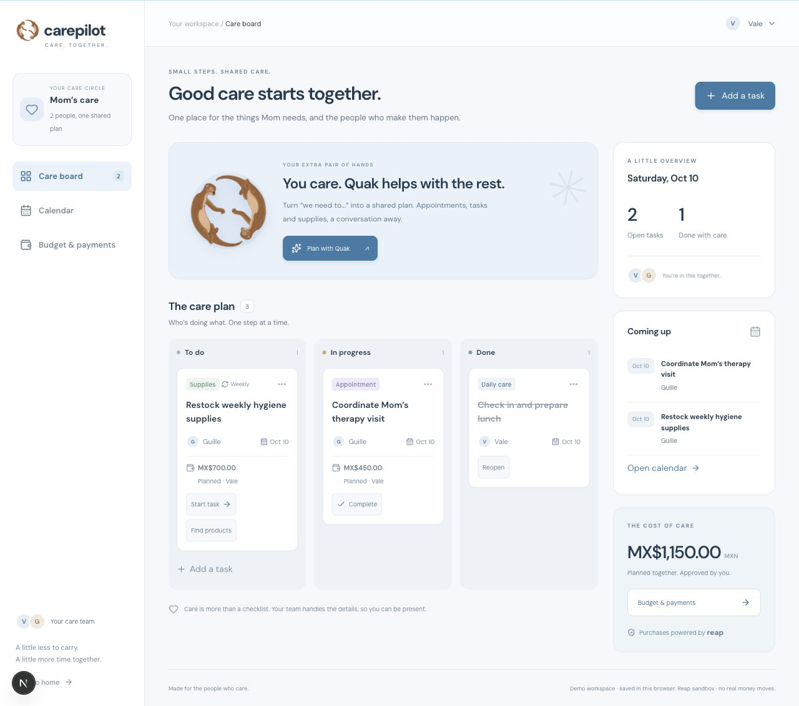

# CarePilot

**A little less to carry. A little more time together.**

Caring for someone you love means holding a lot in your head: the next appointment,
who can help today, supplies running low, and how to cover another expense. Even when
people want to help, the coordination often falls on one person.

CarePilot gives that care a shared home. It helps caregivers turn everyday needs into
clear next steps, divide responsibilities, and plan the cost of care—so there is more
room to be present with the person who matters.



## One care circle, one shared plan

- **Know what needs doing.** A simple care board shows what is to do, in progress,
  and done. Each task has a person responsible and an optional date.
- **See what is coming up.** A shared calendar brings appointments, care tasks and
  restock dates together. Appointment times still need confirmation with the clinic.
- **Share the cost of care.** Plan expenses for medication, therapy, nutrition and
  everyday supplies, and make clear who coordinates and who covers the cost.
- **Ask Quak for a hand.** Describe a need in ordinary language. Quak proposes tasks,
  dates and responsibilities for you to review before adding them to the plan.
- **Prepare a purchase with confidence.** Research supplies, compare supported Reap
  products, request a quote and move through a guided approval flow in the same
  workspace. A planned expense is never treated as an authorized payment.

For example: Guille coordinates a therapy visit, Vale prepares lunch, and the family
plans the next supply restock. Everyone can see their part without turning care into
another complicated dashboard.

## Meet Quak

Quak is your care companion, powered by Nebius Token Factory. It helps organize the
small details that add up: appointments, responsibilities, budgets and product research.

You decide which suggestions to apply. Quak helps coordinate care; it does not diagnose,
prescribe, confirm a clinic booking or authorize a purchase on your behalf.

## Thoughtful payments, powered by Reap

Financial planning belongs alongside the rest of care. Reap provides the commerce
infrastructure for supported supply purchases, while CarePilot keeps the care need,
responsibility and budget visible.

The flow uses real supplier research from Tavily and the Reap catalog. Catalog prices
are references; a Reap quote confirms the final amount and currency. The authenticated
funder reviews the agreement and approves the quoted terms before checkout. Card entry
and approval codes stay on Reap’s hosted pages.

A purchase is shown as completed only after Reap confirms its status, order ID and
final amount. Completing a care task does not mark its purchase as paid.

Built for the **Agentic Hackathon by Reap × AI Builders Mexico**, around everyday care
and spending for someone you love. All payment flows use the **Reap sandbox**; no real
money moves.

## Try it locally

```bash
npm install
cp .env.example .env.local
# Add the service credentials you want to use.
npm run dev
```

Open [localhost:3000/admin](http://localhost:3000/admin) for the care workspace, or `/`
for the landing page. For port 3010, run `npm run dev -- --port 3010`.

Start with **Try a sample plan**, or add your own task, appointment or planned expense.
The three main views are **Care board**, **Calendar**, and **Budget & payments**.
The sample plan contains example tasks, not bookings or purchases.

The board and calendar work without external service credentials. Quak, research and
purchases require their respective services below.

### Service configuration

| Variable | Purpose |
|----------|---------|
| `NEBIUS_API_KEY`, `NEBIUS_BASE_URL`, `NEBIUS_MODEL` | Quak’s language model |
| `TAVILY_API_KEY` | Supplier and product research |
| `REAP_API_TOKEN`, `REAP_BASE_URL`, `REAP_API_VERSION` | Reap Agentic module, SG sandbox |
| `DATABASE_URL` | Accounts and persisted purchase agreements in Postgres |
| `CAREPILOT_APP_ORIGIN` | Application origin; hosted Reap returns require a public HTTPS origin |
| `CARE_AGENT_SESSION_SECRET` | Secret of at least 32 characters for signed sessions and agreements |

Authenticated checkout also needs a CarePilot funder account, the database, a session
secret and a configured return origin. The family name selector is for planning; it
does not grant payment authority.

## What the demo does today

The care plan is saved in this browser, including task progress and dates. It is not
yet a synchronized multi-user workspace. Authenticated purchase runs are stored
separately in Postgres.

Weekly restock reminders help identify recurring needs; they are not an unattended
subscription or automatic charge. Clinical expenses can be planned, but purchases are
limited to products available through supported Reap merchants.

The current purchase budget is **MXN-only**, with no automatic currency conversion.
Quotes in another currency or above the budget are blocked. A verified connection or
a product result is not evidence of a completed checkout.

## For builders

Next.js 16, React 19 and TypeScript power the interface. Server routes connect to
Nebius, Tavily and Reap; payment credentials stay on the server.

| Area | Location |
|------|----------|
| Care board, calendar and budget workspace | `src/components/care/workspace.tsx` |
| Quak conversation and reviewed proposals | `src/components/care/chat.tsx` |
| Product research and quote preview | `src/components/care/research.tsx` |
| Guided authenticated purchase flow | `src/components/care/agent.tsx` |
| Care APIs | `src/app/api/care/` |
| Purchase orchestration, approvals and storage | `src/lib/care-agent/` |
| Reap integration | `src/lib/reap/` |

The former `/care-agent` and `/care-shop` pages redirect into `/admin` so the experience
stays in one workspace. Purchase runs remain protected by verified identity, signed
agreements, budget checks and persisted idempotency keys.

```bash
npm run build
npm run typecheck
npm run lint
npm test
```

For the technical hackathon evaluation guide, see [JUDGES.md](JUDGES.md).
